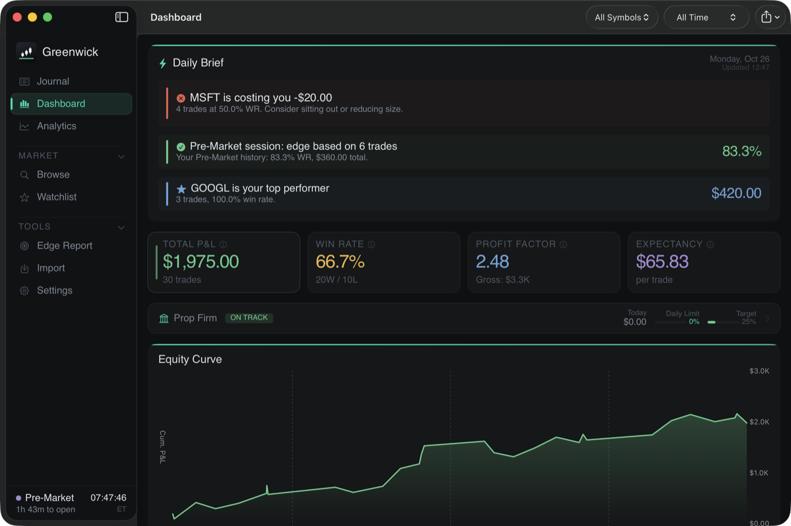
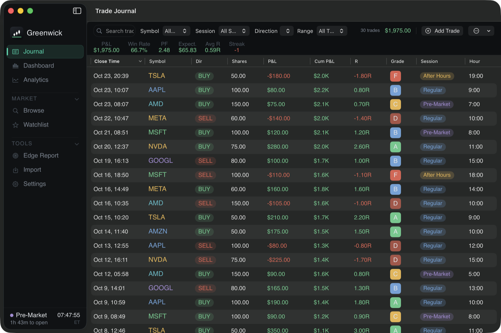
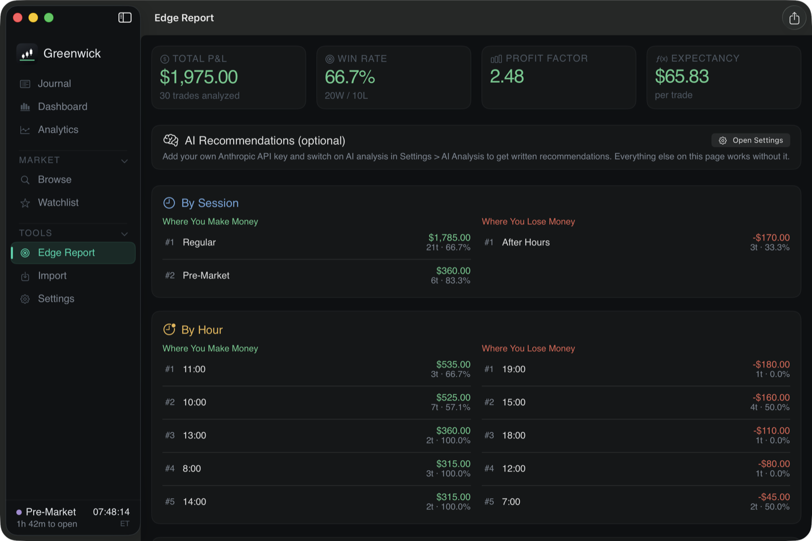
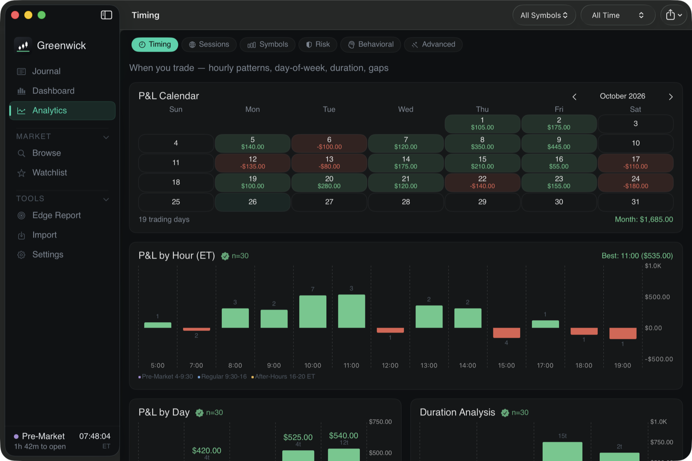
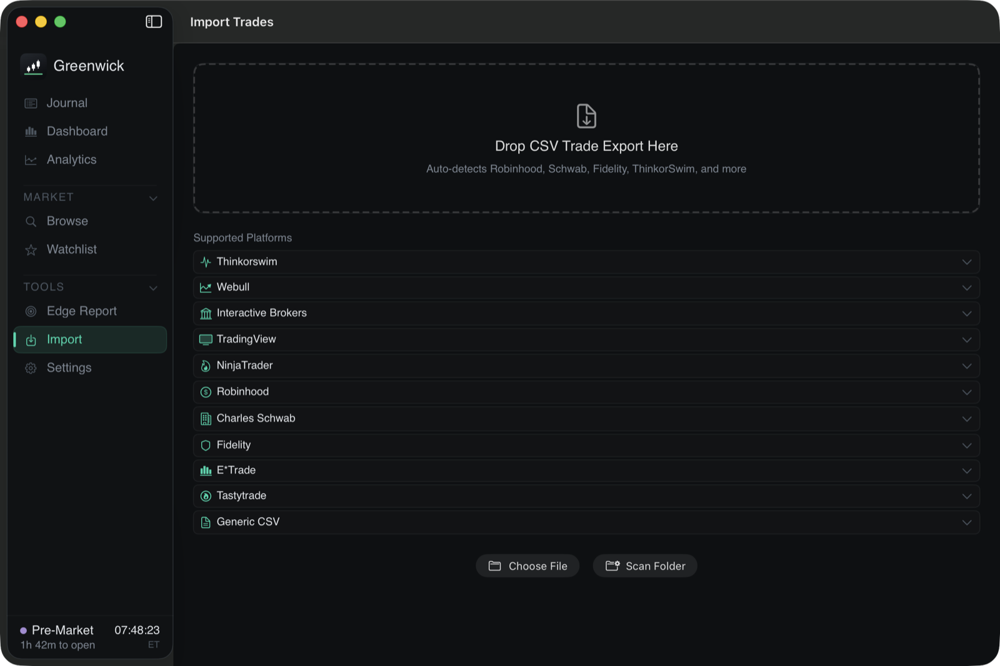

# Greenwick

**A free, open-source trading journal for stock and day traders on the Mac that shows you, in dollars, where you make money and where you lose it.**

Import your broker's trade history, and Greenwick turns it into a journal, a dashboard of
more than 60 analytics, and an Edge Report that ranks your sessions, hours, tickers and
weekdays. It is built for US equities: pre-market, regular and after-hours sessions,
shares, sectors, gaps and earnings days. It is the stock-market sibling of
[Dojix](https://github.com/djctwo/dojix), the forex journal, and shares its analytics
engine.

> Free and open source (GPL-3.0) · native macOS app · **Windows version coming soon.**

Created by [Douglas Cleary](https://github.com/djctwo).



| Journal | Edge Report |
|---|---|
|  |  |
| **Analytics** | **Import** |
|  |  |

*Screenshots show the built-in sample trades. Every number in them is made up.*

## Why Greenwick

- **Free and open source.** Every feature is available to everyone. No trial, no tiers,
  no upgrade screen. The full source code is in this repository under the GPL-3.0.
- **Everything stays on your Mac.** Your journal is a local, encrypted database. There is
  no account to create, no subscription, no cloud sync and no telemetry.
- **App Lock protects the journal with your password.** The journal is always encrypted
  on disk; with App Lock on, its key is sealed with your password, so nothing can be
  decrypted until you unlock Greenwick.
- **AI is optional and uses your own key.** If you add your own Anthropic API key and
  switch on *Allow AI analysis*, the Edge Report can write recommendations. Only summary
  statistics are sent, never your individual trades, notes or account details, and only
  when you click *Run Analysis*.
- **Imports from 10 brokers and platforms:** Thinkorswim, Interactive Brokers, Webull,
  TradingView, NinjaTrader, Robinhood, Charles Schwab, Fidelity, E\*Trade and Tastytrade,
  plus any other CSV through a column-mapping screen.

## Features

- **Imports:** broker exports that list individual buys and sells are paired into
  round-trip trades first-in-first-out, including partial fills and short sales. P&L is
  shown after commissions and fees. Re-importing a file skips trades you already have.
  Sample exports for every supported format are in `TestData/` (all invented).
- **Journal:** filters, search, notes, tags, emotions, checklists, screenshots, manual
  trade entry and a trade-by-trade replay.
- **Dashboard and 60+ analytics:** equity curve, drawdown, calendar heatmap, win rate,
  profit factor, expectancy, R-multiples, Sharpe and Calmar ratios, streaks, Monte Carlo
  and risk of ruin, kill-zone and time-of-day analysis, gap and opening-range analysis,
  sector exposure, execution quality, edge decay, "what to cut" in dollars, and a
  prop-firm challenge tracker.
- **Edge Report:** your top money-makers and money-losers by session, hour, ticker and
  weekday.
- **Exports:** PDF reports and CSV, plus journal backup and restore.
- **Sample trades:** load 30 fictional trades from the welcome screen or *Settings > Load
  Sample Trades* to explore before importing your own; *Remove Sample Trades* deletes only
  those.
- **Encrypted journal:** the database is AES-256-GCM encrypted and never written to disk
  unencrypted; it is decrypted into memory only. API keys live in the macOS Keychain.
- **App Lock with idle auto-lock:** the journal key is sealed with your password
  (PBKDF2-SHA256, 600,000 rounds). Greenwick locks again when it goes to the background
  and after a time without keyboard or mouse activity (Off, 1, 5, 15, 30 or 60 minutes;
  default 15). If an unlock or an App Lock change is still running at that moment, it
  locks as soon as that finishes.
- **Older-copy check:** every save is numbered. If the journal file is replaced by an
  older copy, Greenwick asks before opening it (with App Lock on, only with the password).
- **Password-protected backups:** backups can be encrypted with a password (AES-256-GCM,
  PBKDF2-SHA256 600,000 rounds; on by default when App Lock is on), and every backup is
  validated before a restore. A backup without a password is readable by anyone who gets
  the file, so the password is recommended.

### Optional extras (bring your own key, off by default)

- **AI recommendations** in the Edge Report. Add your own Anthropic API key and switch on
  *Allow AI analysis* in Settings. When you click *Run Analysis*, Greenwick sends summary
  statistics only (totals, and P&L by session, hour, ticker and weekday). Anthropic bills
  your account; a run typically costs a few cents.
- **Quotes and ticker search** in Browse and Watchlist, using your own free Finnhub key
  (finnhub.io). Only ticker symbols are sent.

Connections to both services use HTTPS with certificate pinning. Without keys, everything
else works fully offline.

## Install

Requires macOS 14 Sonoma or later.

1. Open the [Releases page](https://github.com/djctwo/greenwick/releases) and download
   `Greenwick-macOS-unsigned.zip` from the latest release.
2. Unzip it and drag **Greenwick.app** to your Applications folder.

### Opening an unsigned app

Greenwick is not signed with an Apple Developer ID or notarized, so the first time you
open it macOS says it "cannot be opened" or "cannot verify the developer". To open it:

1. In Finder, **right-click** (or Control-click) Greenwick.app and choose **Open**, then
   click **Open** again in the dialog. You only need to do this once.
2. If there is no Open button (newer macOS versions): try to open the app once, then go
   to **System Settings > Privacy & Security**, scroll down to the message about
   Greenwick and click **Open Anyway**, then confirm.

Each release also has a `.sha256` file, so you can check the download with
`shasum -a 256 Greenwick-macOS-unsigned.zip`.

### Build from source

You need a Mac with Xcode 16 or later and XcodeGen (`brew install xcodegen`).

```bash
brew install xcodegen
git clone https://github.com/djctwo/greenwick.git
cd greenwick
xcodegen generate          # creates Greenwick.xcodeproj from project.yml
open Greenwick.xcodeproj   # then press Run, or build from the command line:
xcodebuild -project Greenwick.xcodeproj -scheme Greenwick -configuration Release build
```

The build is signed ad hoc (no Apple account needed). Run the unit tests with:

```bash
xcodebuild test -project Greenwick.xcodeproj -scheme GreenwickUnitTests \
  -destination 'platform=macOS' GREENWICK_BUNDLE_ID=com.greenwick.app.dev
```

Building with a different `GREENWICK_BUNDLE_ID` gives that copy its own data folder and
Keychain entries, so development builds never touch the journal you use day to day.

The UI tests (`GreenwickUITests`) launch and drive the app, so they run in CI (the
`ui-tests` job, which uploads a screenshot of every screen with the sample trades as the
`Greenwick-ui-tests` artifact). To run them yourself, use a Mac or user account without a
Greenwick install you care about:

```bash
xcodebuild test -project Greenwick.xcodeproj -scheme Greenwick -only-testing:GreenwickUITests \
  -destination 'platform=macOS' GREENWICK_BUNDLE_ID=com.greenwick.app.dev
```

## Where your data lives

- Trades: `~/Library/Application Support/Greenwick/Greenwick.sqlite` (encrypted)
- Screenshots: `~/Library/Application Support/Greenwick/Screenshots/` (plain image files)
- Prop firm account size and limits: inside the encrypted journal. Watchlist symbols,
  checklist rules, the inactivity lock setting and display preferences: Greenwick's
  ordinary preferences file.
- The journal's encryption key, the number of its last save (older-copy check) and API
  keys: your macOS Keychain. With App Lock on, the journal key is stored sealed with your
  password, plus a copy macOS releases only after Touch ID or your Mac password (signed
  builds only; unsigned builds can't create it, so there a forgotten App Lock password
  means erasing the journal, which asks for Touch ID or your Mac password first).

The data folder also holds an empty `Greenwick.lock`: only one running copy of Greenwick can
have the journal open at a time (a second copy, e.g. one left in Downloads, shows
"Greenwick is already open" and opens nothing), so two copies can't overwrite each other's
saves. This needs a folder that supports file locks, as your Mac's own disk does. On a
network or external drive without file locks Greenwick can't tell that another copy is
running and opens anyway, so run only one copy there.

Deleting the app leaves this data in place; delete the folder to remove it.

## Built with

Swift 6 · SwiftUI · Swift Charts · GRDB.swift (SQLite) · DM Sans and JetBrains Mono fonts

## License

Copyright © 2026 Douglas Cleary. Greenwick is free software under the
[GNU General Public License v3.0](LICENSE); see [NOTICE](NOTICE). Issues are welcome,
pull requests are not accepted (see [CONTRIBUTING.md](CONTRIBUTING.md)). Report security
problems as described in [SECURITY.md](SECURITY.md).

Greenwick is a journaling tool, not financial advice.

## Other projects

[Dojix](https://github.com/djctwo/dojix), the trade journal for forex traders, and
[Athorize](https://github.com/djctwo/athorize), a self-hosted multi-framework compliance
platform.
